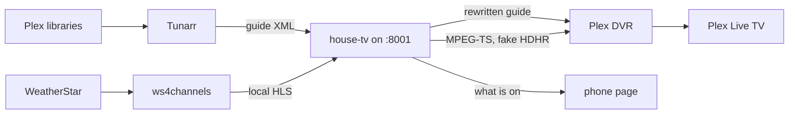

# House TV

A personal cable lineup for the TVs in one house.

Plex Live TV is the cable box. [Tunarr](https://github.com/chrisbenincasa/tunarr) turns a Plex library into channels. A small Python service on the same machine fixes the guide so Plex will accept it, adds a WeatherStar weather channel, and serves a phone page of what is on.

This is a sanitized template of a setup that is already running. The live house keeps its real channel list, playback position, and server notes in a private repo. None of that is here.

## What you get

- Channels described as rules (which shows, which movies, what time of day), not a grid you build by hand
- Three minutes of break between programs, episodes in order, and a cap so one giant series cannot take the channel
- A weather channel Plex treats as an HDHomeRun tuner
- A phone page on port 8001
- A nightly job that picks up new files, files anything you did not assign, and rebuilds a channel unless someone is watching it

## How the pieces connect

Tunarr makes the movie and show channels. The weather channel never goes through Tunarr. Plex has to be on the same machine as `housetv.py`, because the fake tuner only answers on localhost.

## One house's lineup

The names are rooms, not genres. `channels.example.json` is a four-channel starter, not this list. Copy the shape.

| Channel | Name | What it is for |
|---|---|---|
| 2 | The Yard | Cartoons for bigger kids, with a Saturday morning block |
| 3 | The Castle | Preschool, calmer after 7 PM |
| 4 | The Couch | Sitcoms. Also the catch-all for a new show that does not fit anywhere else |
| 5 | The Shop | Cars, tools, documentaries, reality |
| 6 | The Family Room | Family movies |
| 7 | Little Movies | Movies for little kids |
| 8 | The Late Movie | Everything else |
| 9 | The Hearth | Comfort shows |
| 10 | The Bridge | One franchise, played in order |
| 11 | The Den | Heavier drama, mostly after 8 PM |
| 12 | The Clubhouse | Older cartoons that do not belong on the little-kid channel |
| 13 | The Jukebox | Songs, rendered as album-art videos because Tunarr cannot play audio-only files |
| 14 | The Weather | WeatherStar. Not a Tunarr channel |
| 15 | The Stage | Music videos, and a concert at 8 PM |
| 16 | The North Pole | Holiday movies. Stricter ratings only air late |

`scripts/nightly.py` auto-files a new show onto channel 2, 4, 5, 10, 11, or 12 based on rating and genre, and a new movie onto 6, 7, or 8. That matches the table above, not the small example file. Change `assign_show` and `assign_movie` before you turn the nightly job on, or it will sort your library with somebody else's taste.

Show and movie titles have to match Plex exactly.

## Start here

- [docs/REPLICATE.md](docs/REPLICATE.md) is the build guide
- [docs/CHANNELS.md](docs/CHANNELS.md) is every field in `channels.json`

## What was left out on purpose

- The real channel file. It is just a list of what that house owns
- Playback cursors (`cursors.json`), which are where each series left off
- The server address, hostname, and anything used to shell into it
- WeatherStar add-on screens for one home airport and a few family cities
- Station-ID videos and channel art. `scripts/art.py` and `scripts/idents.py` are how those get made

The Plex token is not in git. Scripts read it from Plex's `Preferences.xml` on the server at runtime.

## What you need

- A Linux machine that already runs Plex Media Server, with Plex Pass (Live TV / DVR), Docker, ffmpeg, and Python 3.11 or newer. The Python is stdlib only
- Tunarr on that same machine, pointed at Plex. Written against Tunarr 2026.10.1
- Plex libraries named `TV Shows` and `Movies`. The jukebox also looks for `Jukebox`, `Music Videos Concerts`, and a music library named `Music`
- A Plex client. This house uses Rokus

WeatherStar is [ws4kp](https://github.com/netbymatt/ws4kp) v7.1.6, captured by [ws4channels](https://github.com/rice9797/ws4channels).

## License

MIT. Tunarr, Plex, ws4kp, and ws4channels are their own projects.
